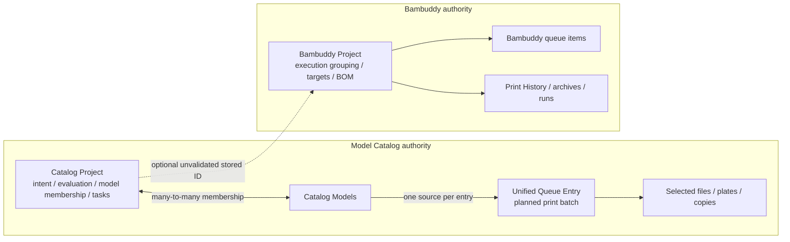
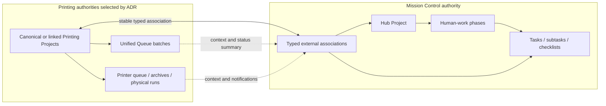

# Printing Project and Mission Control Integration

## Summary

Mission Control must not implement a Model Catalog connector until the printing
domain resolves two overlapping Project concepts:

- **Catalog Project** groups catalog models around intent, evaluation, lifecycle,
  notes, and generic Project tasks.
- **Bambuddy Project** groups printer queue items and Print History/archive records
  and now also owns targets, progress, BOM, due dates, priority, budget,
  hierarchy, templates, and attachments.

The original Catalog design kept these concepts separate with an optional loose
link. That decision assumed a narrower Bambuddy Project than the one that exists
today. Current Bambuddy allows one Project to contain many queue items and many
archives or physical print runs; it is not one execution record per archive.

This document records the current ontology, the evidence that invalidates the
previous Queue-to-task quick start, the decisions required before implementation,
and the invariants that apply regardless of which Project becomes canonical.

## Decision status

**Blocked on a cross-repository Project ownership ADR.**

No connector, Project projection, or task migration should ship until the ADR
selects one of these models:

1. preserve Catalog and Bambuddy Projects with explicit typed links;
2. make Bambuddy Project canonical and attach catalog planning data;
3. make Catalog Project canonical and link Bambuddy execution Projects beneath it;
4. converge both records into one shared Project contract.

The ADR must use a representative live-data inventory before choosing cardinality
or migration rules.

## Current ontology

### Catalog Project

Catalog Project is a sidecar-owned build effort with:

- status `evaluating | planning | active | backlog | completed | archived`;
- many-to-many model membership;
- member state `candidate | chosen | printed | rejected`;
- notes and metadata;
- generic internal tasks with `open | done`;
- a nullable `bambuddy_project_id`.

The Bambuddy ID is stored but is not a foreign key, is not unique, is not
validated, has no shipped picker, and drives no synchronization or rollup.

Catalog Project implementation and design live in
[`rsocko/hass-bambulab-config`](https://github.com/rsocko/hass-bambulab-config):

- `sidecars/model_catalog/app/db_migrations.py`
- `sidecars/model_catalog/app/db_projects.py`
- `sidecars/model_catalog/app/services/working_catalog_service.py`
- `docs/features/model_catalog/design/catalog-redesign-2026-05.md`
- `docs/features/model_catalog/design/projects.md` (superseded historical design)

### Unified Queue Entry

A Unified Queue Entry is one planned print batch or work order:

- one polymorphic source:
  `catalog_model | working_file | working_group | idea`;
- selected files and plates from that source;
- copies requested and completed;
- rank, estimates, notes, and queue lifecycle;
- independent identity through `queue_entry_id`.

The same source can have multiple active Queue Entries. A Queue Entry has no
Catalog Project foreign key, Bambuddy Project link, generic task, or checklist.
Queue file and plate units describe printable scope and print completion, not
human task hierarchy.

The planned "queue a Project" behavior was to create multiple Queue Entries, one
per eligible member model, rather than create one aggregate Project queue row.
Project Queue visibility was intended to be derived from current model membership.
That design remains unimplemented.

### Bambuddy Project

Current upstream Bambuddy describes Project as a grouping for related prints such
as a multi-part printer build. It supports:

- status `active | completed | archived`;
- zero or more printer queue items;
- zero or more Print History/archive records and physical-run rollups;
- targets, progress, BOM, due date, priority, and budget;
- parent/child Projects;
- templates, attachments, and export/import.

Each Bambuddy queue item or archive belongs to at most one Bambuddy Project.
Deleting a Project detaches those records rather than deleting print history.

The active Catalog redesign's description of a Bambuddy `print_project` as one
execution record per archive is stale. Current upstream uses `Project`/`projects`,
and one Project groups many queue and history records.

### Mission Control

Mission Control already owns the generic work-management capabilities required by
the printing effort:

- local `mc-owned` tasks;
- task hierarchy and checklist items;
- dependencies, priority, dates, effort, reminders, and history;
- many-to-many Hub Project membership;
- Project phases and milestones;
- cross-source organization and planning views.

An MC source list is connector-native provenance. It is not a substitute for a
lifecycle-bearing printing initiative. Queue state and external Project status
must remain structured source context rather than being flattened into tags.

## Historical intent and drift

Existing design did consider linking Catalog and Bambuddy Projects:

- the superseded Catalog Projects design introduced Catalog Projects because
  Bambuddy grouped print outcomes while catalog models and Working Groups lacked a
  common intent and lineage container;
- it proposed an **optional loose Bambuddy Project reference**, not convergence;
- the bulk-ingestion assessment repeated the loose-link recommendation;
- [`rsocko/hass-bambulab-config#1373`](https://github.com/rsocko/hass-bambulab-config/issues/1373)
  explicitly asked whether the concepts were the same and retained separate
  Catalog concepts;
- [`rsocko/hass-bambulab-config#1134`](https://github.com/rsocko/hass-bambulab-config/issues/1134)
  included optional Bambuddy linkage but allowed it to be deferred.

The designs have not been revisited since Bambuddy Project expanded into planning.
As a result, both systems now own overlapping fields and user mental models.

## Tasks were designed at the Catalog Project level

The shipped generic task table is `model_catalog_project_tasks`, with a required
Catalog Project foreign key. The task backend design allows
`none | internal | github | mstodo`, but only `internal` CRUD shipped.

Design examples include:

- buy hardware or material;
- install heat inserts;
- glue or assemble parts;
- organize tools;
- prepare publication metadata;
- post Project photos.

No generic task entity shipped for Queue Entries, queue file/plate units, models,
Working Files, intake jobs, slicer jobs, or Bambuddy Projects. Queue mockups show
Files and Plates plus Info and Notes, not a Tasks surface.

## Why the previous Custom REST recommendation is insufficient

The earlier Connector Expansion Review proposed mapping Unified Queue entries
directly to MC tasks through Custom REST. That is technically possible but
semantically unsafe:

- Queue lifecycle is print-batch state, not human task status.
- Queue rank is ordering, not task priority.
- files, plates, copies, and print outcomes remain source-owned.
- flattening Queue Entries does not resolve Catalog Project vs Bambuddy Project.
- two-way task write-back would create a second authority for Queue lifecycle.
- migrating Catalog Project tasks still requires explicit Project identity and
  association contracts.

Custom REST may remain useful for a temporary read-only experiment, but it is not
the architecture for `rsocko/mission-control#1205`.

## Required Project ownership ADR

### Option A: preserve both Projects with typed links

Catalog retains model membership, evaluation, and catalog intent. Bambuddy retains
execution planning, printer queue/archive membership, targets, BOM, and run
rollups. Replace the singular stored ID with explicit typed associations. An MC
Hub Project may coordinate one or more records of each type.

This is least disruptive but requires clearer UI boundaries and decisions about
duplicated planning fields.

### Option B: Bambuddy Project becomes canonical

Bambuddy owns Printing Project identity and execution lifecycle. Catalog model
membership and evaluation become a sidecar extension. This aligns identity with
queue and history but forces pre-print evaluations and model families to acquire a
Bambuddy identity.

### Option C: Catalog Project becomes canonical

Catalog owns Printing Project identity and pre-execution intent. Bambuddy Projects
become execution groupings beneath it. This supports efforts that may never print,
but risks retaining duplicate BOM, targets, dates, priority, and hierarchy.

### Option D: converge into one shared Project record

Replace both records with one contract. This gives one visible concept but has the
highest migration and coupling cost because membership, lifecycle, hierarchy,
deletion, and offline authority differ.

### ADR questions

The ADR must settle:

1. canonical identity and owner;
2. whether evaluation/model-family efforts exist before printer execution;
3. model membership and member-state ownership;
4. printer queue, archive, and physical-run membership;
5. BOM, targets, budget, dates, priority, hierarchy, templates, and attachments;
6. lifecycle statuses and allowed transitions;
7. deletion/archive behavior and historical retention;
8. offline authority and reconciliation;
9. one logical effort to many Bambuddy Projects;
10. one Bambuddy Project to many catalog initiatives;
11. terminology and navigation across Catalog, Print Queue, Print History,
    Bambuddy, and Mission Control;
12. migration of existing Projects and stored Bambuddy IDs.

## Invariants for Mission Control integration

These decisions do not depend on which Project model wins:

1. **Mission Control is the sole generic task authority.**
2. Existing `model_catalog_project_tasks` migrate to MC local tasks.
3. Planned Catalog GitHub and Microsoft To Do task adapters are retired.
4. Queue Entries remain printing-domain records unless the ADR changes their
   ontology explicitly.
5. Queue files, plates, and copies remain source-owned metadata, not authoritative
   MC checklist state.
6. MC task completion does not silently advance Catalog, Queue, or Bambuddy
   lifecycle.
7. MC phases organize human workstreams; they do not mirror external status.
8. Cross-system identity is authority- and instance-qualified.
9. Integration operations are idempotent and backed by cursors and reconciliation.
10. Unlinking or deleting planning records never deletes Print History or MC task
    history.

## Post-ADR role for Mission Control

MC should own actionable work such as evaluation, purchasing, file preparation,
blocked-print resolution, assembly, finishing, packaging, delivery, publication,
and metadata review. Queue and history records should appear as linked context and
rollups. A Queue Entry should not automatically create a second task lifecycle.

## Delivery sequence

1. **Project ownership ADR**
   - inventory representative live Catalog/Bambuddy Project data;
   - reconcile code, tests, mockups, active and superseded designs;
   - select the canonical or linked Project model;
   - correct stale Bambuddy terminology and cardinality.
2. **Printing identity and lifecycle foundation**
   - add durable authority-instance identity;
   - implement the selected Project association or canonical identity;
   - migrate stored Bambuddy IDs;
   - add Project/membership/link events and cursor-based reads;
   - resolve Queue transition and archive-completion drift.
3. **Mission Control integration foundation**
   - add typed external associations for Hub Projects and tasks;
   - add scoped service authentication and audit;
   - add idempotent link/create/update APIs;
   - add health, cursor checkpoints, replay, and reconciliation.
4. **ADR-selected Hub Project projection**
   - create or link MC Hub Projects using the chosen cardinality;
   - surface exact external status and Queue/history rollups as read-only context;
   - provide deep links to authoritative printing UIs.
5. **Task bridge and migration**
   - migrate Catalog internal tasks exactly once;
   - record durable legacy-to-MC task mappings;
   - replace Catalog task mutation UI with MC summaries, create actions, deep links,
     health, and errors;
   - retain restart safety and a rollback window before retiring local writes.
6. **Task-producing workflows**
   - route BOM shopping, publication preparation, evaluation follow-up, assembly,
     delivery, and approved exceptions to MC;
   - use notifications first for blocked, failed, or unmatched conditions.
7. **Validation and cutover**
   - test restore/reseed identity, duplicates, missed events, offline MC, partial
     migration, deletion/archive, and rollback;
   - update operations and troubleshooting documentation;
   - correct stale GitHub work-item status;
   - close `rsocko/mission-control#1205` after acceptance.

## Acceptance criteria

- An accepted ADR resolves Catalog Project and Bambuddy Project ownership.
- Documentation no longer claims one Bambuddy Project per archive.
- Cross-system Project identity survives restore, reseed, retries, and replay.
- Mission Control is the only generic task authority.
- Catalog tasks migrate once with durable mapping and rollback evidence.
- Printing lifecycle remains correct while MC is offline.
- MC task completion never silently changes printing lifecycle.
- No migration deletes Print History or MC task history.

